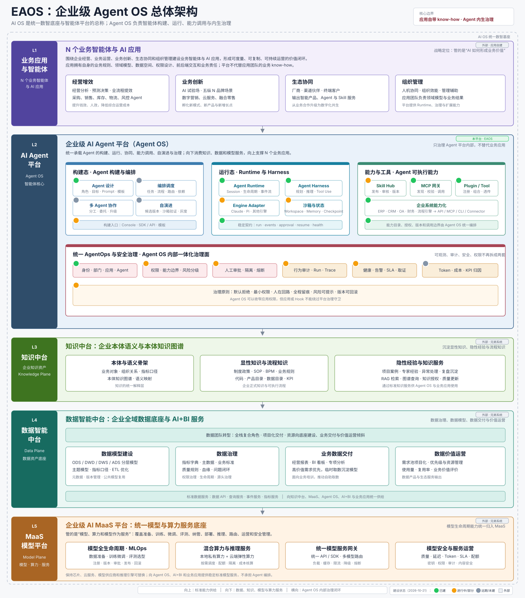
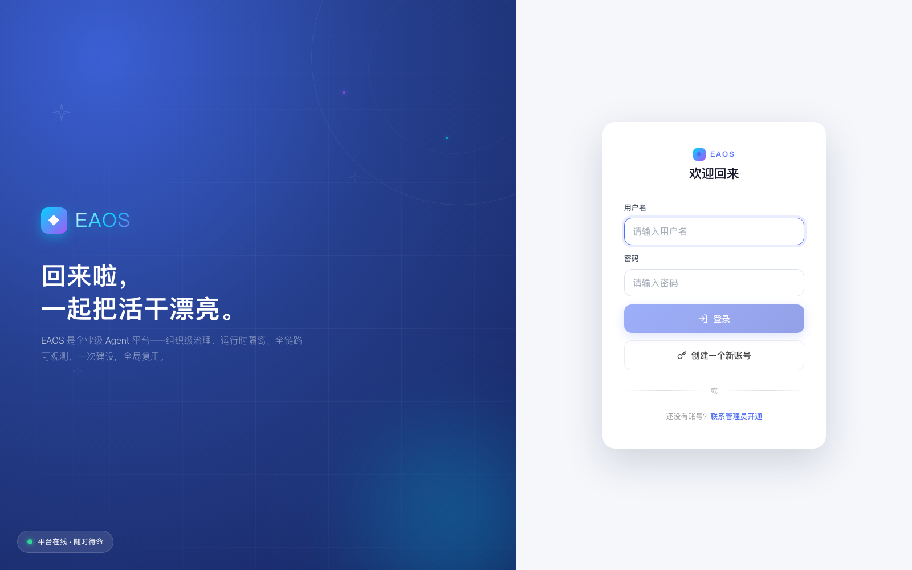

# EAOS — Enterprise Agent OS

**[中文文档](README_CN.md)**

> **The first open-source enterprise agent platform built natively on the Claude Agent SDK.**
> Org-level governance × per-chat runtime isolation × full observability — build once, reuse everywhere.

https://github.com/user-attachments/assets/cb67ce82-0978-4363-8561-98b2ee365195

🎬 [HD download (50s)](https://github.com/jameslian87v5/eaos/releases/download/v0.1.0/eaos-intro.mp4)

---

## Why this project

The Claude Agent SDK is arguably the strongest agent harness available today — native Skill tools, PreToolUse interception, a plugin ecosystem, streaming contracts, and cold session resume. But it was born as a **single-developer tool**.

When an enterprise puts agents into real business workflows — quoting, order entry, pricing, reconciliation — every team ends up rebuilding the same three capabilities, and getting them wrong:

1. **Harness reuse** — everyone integrates the SDK separately: session management, streaming, tool loop, resume. Swap the model and everything breaks.
2. **Permission governance** — which tools an agent may use, which intranet systems it may touch, under what identity, where credentials live. Every app answers these on its own (or doesn't). Audit can't see through.
3. **Observability** — agents are long-lived, non-deterministic executors. Traditional APM can't tell you "what is the agent doing right now".

Every application needs all three; none should build them alone. EAOS sinks them into the platform layer: build once, reuse everywhere.

## Positioning

```
Claude Code open ecosystem  ×  Enterprise business-agent platform
```

This intersection is empty today:

- Claude Code–ecosystem projects (claudecodeui, vibe-kanban, remote-agent…) are all **developer tools** — no org governance, no business-agent runtime.
- Enterprise agent platforms (Octop, Dify-style) **don't use the Claude SDK** — Octop builds on deepagents, skills are simulated via prompt injection, governance is a two-tier admin/owner model.
- Cloud-hosted offerings (Cowork, Managed Agents) are **not self-hostable and not self-governable**.

**EAOS occupies exactly this intersection**: Claude SDK–native engine × enterprise-grade governance and isolation.

## Four core strengths

### ① Enterprise governance (the differentiating core)

- **Org multi-tenancy**: three roles — admin / org_admin / user. `orgId` comes only from server-side trusted sources.
- **Entitlement overlay**: deny-by-default. Effective capability = app allowlist ∩ org entitlement ∩ agent activation.
- **Dual approval channels**: host-side approval manager + in-container PreToolUse hook — humans in the loop for dangerous operations.
- **End-to-end audit**: connectors, capability changes, grants, approvals — all on record.
- **Skill supply chain**: ZIP import validation (path traversal / oversize / symlink rejection) → quarantine → manual review → disabled by default.

### ② Claude Agent SDK native (not a wrapper)

- Native Skill tool calls (real tool boundaries — approvable, auditable) + PreToolUse hooks + the plugin ecosystem.
- SKILL.md open format — third-party skill-marketplace content is **natively consumable** (deepagents-style frameworks can only inject it as prompt material).
- Streaming-input long sessions + `claudeSessionId` cold resume; the full SDK event contract passes through.

### ③ Agent runtime isolation

- **One container per chat**: dedicated Docker container + two named volumes (workspace / Claude home). Stop deletes the container; state cold-resumes.
- **Credentials never leave the host**: external-system credentials are AES-256-GCM encrypted on the host; agents receive scoped tokens that **die with their runtime**.
- MicroVM-level isolation is under active validation (POC accepted).

### ④ Observability

- Already built: token usage, session & container diagnostics, health checks, dual audit views, security center.
- On the roadmap: LLM call-level tracing (model/tool calls, latency, cost attributed by department / app / agent — Langfuse-quadrant parity).

> One-liner: **credentials stay on the host, scoped tokens enter the container, tokens die when the runtime dies.**

## Comparison

| | EAOS | Octop (Tencent Cloud) | claudecodeui-style | Dify-style | Cowork / cloud-hosted |
|---|---|---|---|---|---|
| Harness engine | **Claude Agent SDK native** | deepagents (LangGraph) | Claude Code (shared process) | Custom workflow engine | Claude SDK (closed, hosted) |
| Positioning | Enterprise business-agent platform base | Self-hosted multi-user AI assistant | Dev-tool web UI | LLM app builder | Hosted office agent |
| Org / multi-tenant governance | **Three-tier org + entitlement overlay** | admin/owner two-tier | None | Workspace-level | Platform-owned |
| Approval + audit | **Dual-channel + end-to-end** | Limited in-house | Relies on local CLI | App layer | Platform black box |
| Credential custody | **Host-held + scoped tokens die with runtime** | Early form, no org overlay | None | App-level config | N/A |
| Runtime isolation | **One container per chat (MicroVM path)** | In-process plugins | Shared process | Deployment-level containers | Cloud sandbox |
| Skill ecosystem | **SKILL.md open format, native** | Same format but prompt-injected | Inherits local Claude Code | Proprietary format | Official ecosystem |
| Self-hosted + open source | ✅ MIT | ✅ MIT (governance model doesn't fit enterprises) | ✅ | ✅ | ❌ |

## Architecture



The control plane (agent definitions / profiles / entitlements / audit) is strictly separated from the data plane (container runtime / SDK query / tool execution). All capabilities are translated through `CapabilityProvider.resolve()` before injection — frontends and users **never** set tools, plugins, or host paths directly.



## Quickstart

Prerequisite: Node.js 18+. Local evaluation **does not require Docker** (`local` mode runs agents in-process).

```bash
git clone https://github.com/jameslian87v5/eaos.git && cd eaos
npm install
cp .env.example .env
```

Edit two lines in `.env`:

- `ALLOW_DEV_JWT_SECRET=1` — local evaluation only. The platform is **fail-fast** by default: it refuses to boot without a configured `JWT_SECRET`. For real deployments use `JWT_SECRET=$(openssl rand -hex 32)`.
- `ANTHROPIC_API_KEY=<your key>` — defaults to the Zhipu GLM endpoint (`ANTHROPIC_BASE_URL=https://open.bigmodel.cn/api/anthropic`). For Anthropic's official API, set `ANTHROPIC_BASE_URL=https://api.anthropic.com`. Any Anthropic-compatible endpoint works.

```bash
npm run dev        # server :3001 + client :5173
# open http://localhost:5173 → sign in with admin / admin123
# first login forces a password change (seed credentials are never allowed
# to run wild — HTTP and WS are both gated until rotation)
```

### Docker runtime (one container per chat — the isolation story itself)

```bash
docker build -f docker/Dockerfile -t eaos-agent:latest .
RUNTIME_MODE=docker npm start
```

After sending a message to trigger container creation, `docker ps` shows `eaos-agent-`-prefixed containers — one isolated container per conversation, deleted on stop, resumable from cold state.

## Roadmap

- End-user self-service building (experts + skills; capability ceiling = caller's own entitlement ∩ app allowlist)
- Engine Adapter formalization: deepagents/Octop harness as a second engine (for Python-ecosystem scenarios) with equivalent governance
- Optional Octop component adoption: Memory (org memory, migratable) / Browser (web operations via MCP) / Gateway (IM reach)
- LLM call-level tracing & cost attribution, alerting / SLA, circuit breaking, version rollback

## Security & license

Security model and vulnerability reporting: [SECURITY.md](SECURITY.md). License: [MIT](LICENSE).

> Acknowledgement: the control-plane shape of this project was inspired by the connector/skill packaging design of Tencent Cloud's open-source Octop (MIT). The governance model and harness selection are independently designed.
