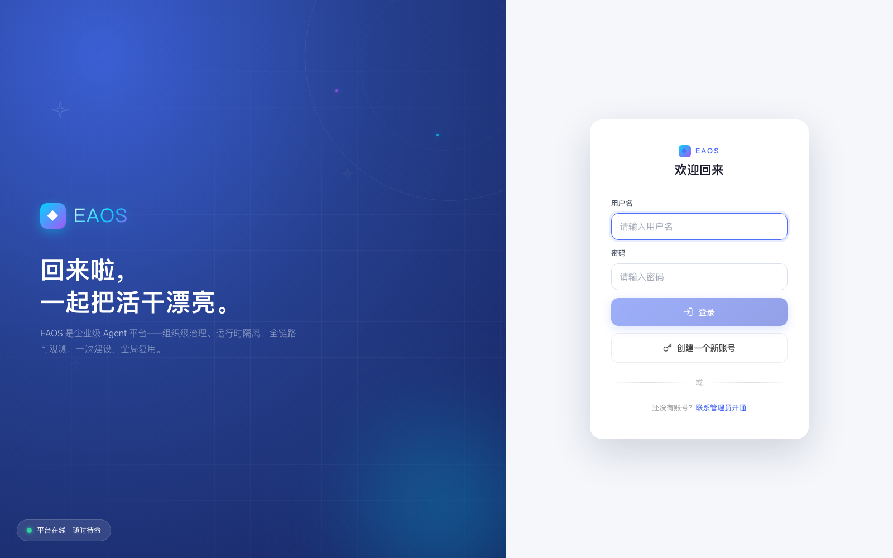
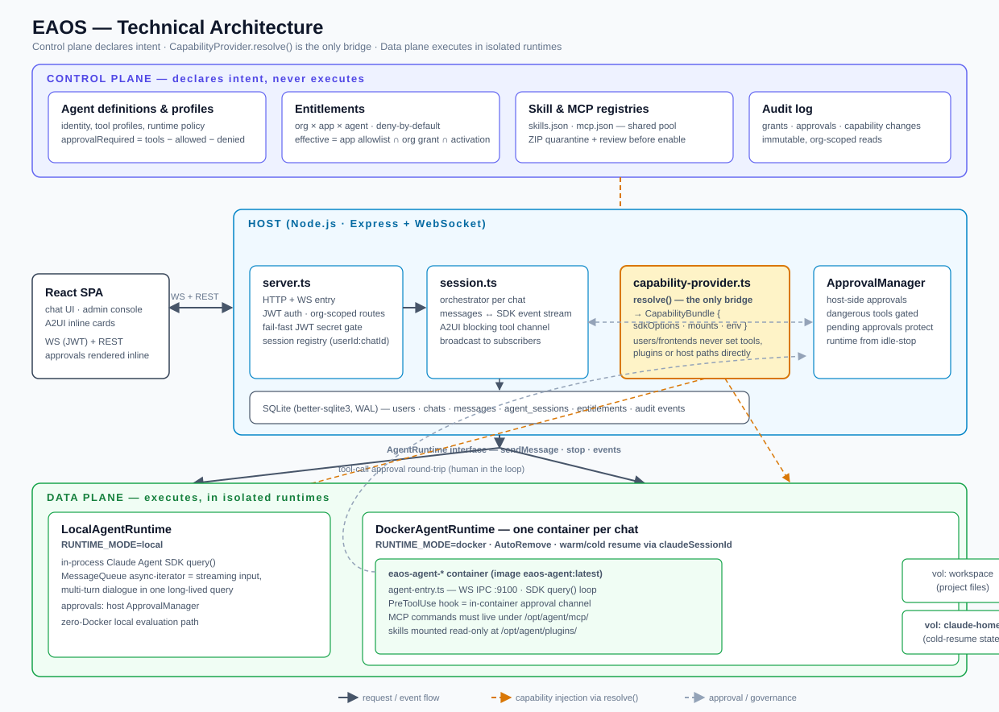
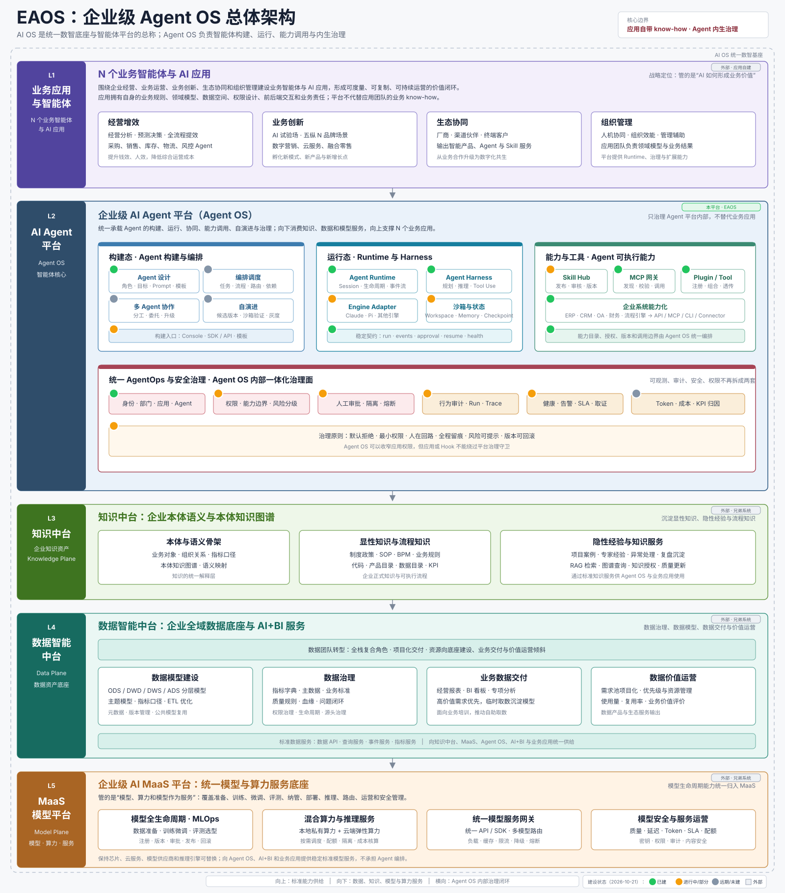

# EAOS — Enterprise Agent OS

**[English](README.md)**

> **首个基于 Claude Agent SDK 的开源企业级 Agent 平台。**
> **The first open-source enterprise agent platform built natively on the Claude Agent SDK.**
> 组织级治理内核 × Agent 运行时隔离 × 可观测，一次建设，全局复用。

https://github.com/user-attachments/assets/cb67ce82-0978-4363-8561-98b2ee365195

🎬 [高清版下载（50 秒）](https://github.com/jameslian87v5/eaos/releases/download/v0.1.0/eaos-intro.mp4)



---

## 为什么做这个项目

Claude Code / Claude Agent SDK 是今天公认最强的 agent harness——原生 Skill 工具、PreToolUse 拦截、插件生态、流式契约、会话冷恢复。但它生来是**单人开发工具**。

当企业把 agent 铺进报价、录单、核价、对账这些真实业务环节时，每个团队都在重复造三类能力，而且很难造对：

1. **Harness 复用**——各自接 SDK、各自写会话管理/流式/工具循环/断点恢复，模型一换全改一遍；
2. **权限治理**——agent 能用哪些工具、能碰哪些内网系统、以什么身份碰、凭证放哪里，每个应用各自回答（或不回答），审计无法穿透；
3. **可观测**——agent 是长生命周期、非确定性执行体，传统 APM 看不见「agent 在干什么」。

这三类能力**每个应用都需要，但都不该由应用各自建**。EAOS 把它们沉淀为平台级服务：一次建设，全局复用。

## 核心站位

```
Claude Code 开源生态  ×  企业级业务 Agent 平台
```

这个交叉点今天是空的：

- Claude Code 系开源项目（claudecodeui、vibe-kanban、remote-agent……）全是**开发工具**，无组织治理、无业务 agent 运行时；
- 企业 agent 平台（Octop、Dify 类）**都不用 Claude SDK**——Octop 基于 deepagents，skill 靠 prompt 注入模拟，治理只有 admin/owner 二元；
- 云厂商托管方案（Cowork、Managed Agents）**不自托管、不可自治理**。

**EAOS 占的就是这个交叉点**：Claude SDK 原生引擎 × 企业级治理与隔离。

## 四大核心优势

### ① 企业级治理（差异化内核）

- **组织多租户**：admin / org_admin / user 三档角色，orgId 只来自服务端可信源
- **entitlement 叠加授权**：deny-default；能力生效 = 应用允许 ∩ 组织授权 ∩ agent 激活三者交集
- **审批双通道**：host 侧审批管理器 + 容器内 PreToolUse hook，危险操作人在回路
- **全链路审计**：connector、能力变更、授权、审批全程留痕
- **Skill 供应链治理**：ZIP 导入校验（路径穿越/超限/symlink 拒止）→ quarantine → 人工审查 → 默认不启用

### ② Claude Agent SDK 原生（不是套壳）

- native Skill 工具调用（真实工具边界，可审批、可审计）+ PreToolUse hook + 插件生态
- SKILL.md 开放格式——第三方技能市场内容**原生可消费**（deepagents 系只能当 prompt 素材注入）
- 流式输入长会话 + `claudeSessionId` 冷恢复；SDK 事件契约完整透传

### ③ Agent Runtime 隔离

- **每 chat 一容器**：独立 Docker 容器 + 双命名卷（workspace / Claude home），stop 即删、状态可冷恢复
- **凭证不出 host**：外部系统凭证 AES-256-GCM 托管在 host；agent 只拿 scoped token，**随 runtime 失效**
- MicroVM 级隔离路线在验（POC 已验收）

### ④ 可观测

- 平台级已建：Token 用量、会话与容器诊断、健康检查、双审计视图、安全中心
- 路线图上：LLM 调用级 trace（模型/工具调用、延迟、成本按部门/应用/agent 归因，对标 Langfuse 象限）

> 一句话故事：**凭证在 host，token 进容器，runtime 死 token 死。**

## 与业界对比

| | EAOS | Octop（腾讯云） | claudecodeui 类 | Dify 类 | Cowork / 云托管 |
|---|---|---|---|---|---|
| Harness 引擎 | **Claude Agent SDK 原生** | deepagents（LangGraph） | Claude Code（共享进程） | 自研 workflow 引擎 | Claude SDK（闭源托管） |
| 定位 | 企业业务 Agent 平台底座 | 自托管多用户 AI 助手 | 开发工具 Web UI | LLM 应用搭建平台 | 托管办公 agent |
| 组织/多租户治理 | **org 三档 + entitlement 叠加** | admin/owner 二元 | 无 | workspace 级 | 平台自有 |
| 审批 + 审计 | **双通道 + 全链路** | 有限自建 | 依赖本地 CLI | 应用层 | 平台黑盒 |
| 凭证托管 | **host 托管 + scoped token 随 runtime 失效** | 有雏形，无 org 叠加 | 无 | 应用层配置 | 不适用 |
| Runtime 隔离 | **每 chat 一容器（MicroVM 路线）** | 进程内插件 | 共享进程 | 部署级容器 | 云沙箱 |
| Skill 生态 | **SKILL.md 开放格式原生** | 同格式但 prompt 注入执行 | 继承本地 Claude Code | 自有格式 | 官方生态 |
| 自托管 + 开源 | ✅ MIT | ✅ MIT（治理模型不适配企业） | ✅ | ✅ | ❌ |

## 架构



控制平面（agent 定义 / profile / 授权 / 审计）与数据平面（容器 runtime / SDK query / 工具执行）严格分离；所有能力经 `CapabilityProvider.resolve()` 翻译后注入，前端与用户**永不**直设工具、插件或宿主机路径。



## Quickstart

前置：Node.js 18+。本地体验**无需 Docker**（`local` 模式进程内运行 agent）。

```bash
git clone https://github.com/jameslian87v5/eaos.git && cd eaos
npm install
cp .env.example .env
```

编辑 `.env` 两处：

- `ALLOW_DEV_JWT_SECRET=1` —— 仅本地体验。平台默认 **fail-fast**：未配置 `JWT_SECRET` 时拒绝启动。正式部署改为 `JWT_SECRET=$(openssl rand -hex 32)`
- `ANTHROPIC_API_KEY=<你的 key>` —— 默认走智谱 GLM 端点（`ANTHROPIC_BASE_URL=https://open.bigmodel.cn/api/anthropic`）；用 Anthropic 官方就把 `ANTHROPIC_BASE_URL` 改为 `https://api.anthropic.com`。任何 Anthropic 兼容端点均可

```bash
npm run dev        # server :3001 + client :5173
# 打开 http://localhost:5173 → admin / admin123 登录
# 首登强制改密（种子里程碑口令不允许裸奔，改密前 HTTP/WS 双门禁拦截）
```

### Docker 运行时（每 chat 一容器 —— 隔离卖点本体）

```bash
docker build -f docker/Dockerfile -t eaos-agent:latest .
RUNTIME_MODE=docker npm start
```

发一条消息触发容器创建后，`docker ps` 可见 `eaos-agent-` 前缀容器——每个对话一个独立容器，stop 即删、状态可冷恢复。

## Roadmap

- 终端用户自服务构建（专家 + 技能，能力上界 = 本人授权 ∩ 应用允许）
- Engine Adapter 正式化：deepagents/Octop Harness 作第二引擎（Python 生态场景），治理等价性不变
- Octop 组件按需引入：Memory（组织记忆，可迁移）/ Browser（网页操作，经 MCP）/ Gateway（IM 触达）
- LLM 调用级 trace 与成本归因、告警/SLA、熔断、版本回滚

## 安全与许可

安全模型与漏洞报告见 [SECURITY.md](SECURITY.md)。License：[MIT](LICENSE)。

> 致谢：本项目控制平面形态参考了腾讯云开源的 Octop（MIT）的 connector/skill 包设计，治理模型与 harness 选型为独立自研。
